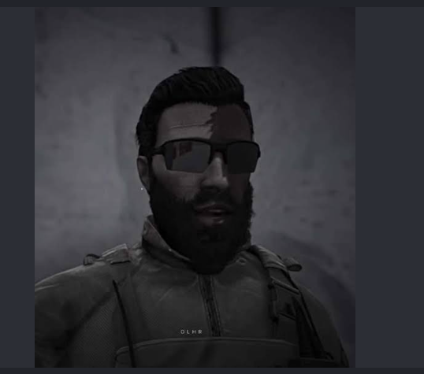
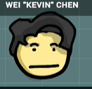
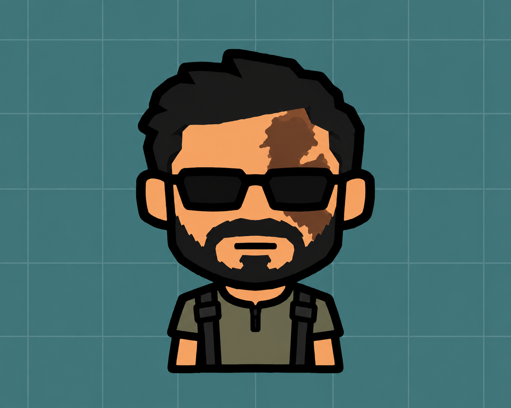

# brave — العب بالعربي

تعريب **Scam With Your Friends**، مع أصوات عربية وتعرّف محلي على كلامك وشخصيات تختار صفاتها.

[تحميل آخر إصدار](https://github.com/0xtaim24/brave-arabic-games/releases/latest) · [Discord](https://discord.gg/ZCxu8kXkS) · [دعم التطوير عبر PayPal](https://www.paypal.com/donate/?hosted_button_id=HU98R2TSB4ZCY)

## البداية السريعة

1. تحتاج نسخة اللعبة مثبتة من Steam على **Windows 10 أو 11 بنظام 64-bit**.
2. من [صفحة الإصدارات](https://github.com/0xtaim24/brave-arabic-games/releases/latest)، حمّل **brave-Setup-1.3.1.exe** وثبّته. ملفات Source code للمطورين وليست البرنامج الجاهز.
3. افتح brave. تختار الأداة مجلد اللعبة تلقائيًا؛ إذا لم تجده اضغط «اختيار» وحدد المجلد الذي يحتوي ملف تشغيل اللعبة.
4. أغلق اللعبة، ثم اضغط **«ضبط تلقائي لجهازي»** وبعده **«تطبيق التحسينات»**. انتظر انتهاء التنزيل والتجهيز.
5. افتح اللعبة واختر العربية، وتأكد من اختيار ميكروفونك الصحيح داخل اللعبة. لا يلزم إبقاء الأداة مفتوحة أثناء اللعب.

أول تجهيز يحتاج إنترنت ومساحة للنماذج المختارة. بعد تنزيلها يعمل التعرّف وتوليد الصوت محليًا. **هذا لا يحوّل اللعبة كلها إلى لعبة بلا إنترنت**: اتصال اللعبة وخدمة الردود واللعب الجماعي تخضع للعبة نفسها.

المثبّت الحالي غير موقّع بشهادة تجارية. تحقّق من أنك حمّلته من هذا المستودع، ولا تعطّل حماية الجهاز لتشغيل ملف غير موثوق.

## ماذا يضيف الإصدار 1.3.1؟

- تحسين الترجمة وعرض الحروف العربية، مع محرر لتعديل النصوص حسب رغبتك.
- ردود عربية بلهجات متعددة، مع المحافظة على دور المتصل وسيناريو اللعبة؛ وخيار ردود قصيرة.
- عشرة أصوات عربية جاهزة محليًا عبر Supertonic، واختيارات للأداء حسب الجهاز.
- تعرّف عربي عبر **Cohere Transcribe Arabic**، مع Qwen ASR وWhisper كبدائل.
- اختبار للميكروفون ومقارنة الكلام المنسوخ بالنص الذي نطقته وتجربة النماذج على نفس التسجيل.
- مكتبة شخصيات: صورة واسم وصفات وخلفية ولهجة وصوت ثابت لكل شخصية.
- استنساخ صوت اختياري من تسجيل لديك حق استخدامه، وسرعة كلام قابلة للتعديل، وخيار تحريك الفم المرسوم مع الصوت.
- نسخ احتياطي لملفات اللعبة التي تتغير، وتحديث تلقائي للأداة.

**الإصدار العام لا يحتوي شخصية تجريبية لشخص حقيقي، ولا صورته ولا تسجيل صوته.** تبدأ مكتبة الشخصيات فارغة للمستخدم الجديد. التحديث يحتفظ بمكتبتك المحلية الموجودة.

## التحديث التلقائي

النسخة المنشورة 1.0.1 وما بعدها تفحص التحديثات عند تشغيل الأداة مع الإنترنت. عند توفر إصدار عادي أحدث، ينزل في الخلفية ويُثبّت عند إغلاق الأداة أو الضغط على زر التحديث. ابتداءً من 1.3.1، يتكرر الفحص كل أربع ساعات إذا بقيت الأداة مفتوحة.

**بعد تحديث الأداة، أغلق اللعبة واضغط «إعادة التطبيق» مرة واحدة** حتى تصل التحسينات إلى ملفات اللعبة. سيظهر تنبيه بذلك. تحديث برنامج brave وتطبيق التعديلات على اللعبة خطوتان مختلفتان. النماذج الجديدة اختيارية وقد تحتاج تنزيلًا منفصلًا؛ لا تنزّل الأداة كل النماذج تلقائيًا.

إذا لم يظهر التحديث، أغلق الأداة وافتحها من جديد، وتحقق من الإنترنت. يمكنك تثبيت آخر ملف من [Releases](https://github.com/0xtaim24/brave-arabic-games/releases/latest) فوق النسخة الحالية. إصدارات beta ليست قناة التحديث العام. الرابط القديم v1.0.1 يبقى أرشيفًا؛ استخدم رابط **آخر إصدار** للمشاركة.

بعد تحديث اللعبة من Steam قد تحتاج إعادة التطبيق أيضًا. خيار التطبيق التلقائي اختياري، ولا يعدّل ملفات لعبة قيد التشغيل.

## اختيار نموذج التعرّف على الكلام

ابدأ بالضبط التلقائي، ثم جرّب ميكروفونك ولهجتك. الأداء يتأثر بالمعالج والذاكرة وكرت الشاشة وضغط اللعبة.

| الخيار | حجم التنزيل التقريبي | الاستخدام |
| --- | --- | --- |
| Cohere Arabic Q5 | 1.77 GB | خيار عربي متوازن؛ هو النموذج المستخدم في اختبار التطوير الحالي |
| Cohere Arabic Q8 | 2.41 GB | نسخة أكبر تحتاج ذاكرة أكثر؛ قارن النتيجة على كلامك |
| Qwen Arabic الخفيف | 850 MB | بديل أقل حجمًا؛ الدقة تختلف حسب اللهجة |
| Whisper | حسب الحجم المختار | بدائل خفيفة وأكبر، مع خيارات CPU وCUDA عند توفرها |

Cohere وQwen يستخدمان Vulkan على كرت متوافق عند نجاح التهيئة، أو المعالج. لا يشترطان كرت NVIDIA أو اشتراك API. إعداد CUDA الاختياري يخص مسار Whisper فقط. الحجم على القرص ليس مقدار الذاكرة المطلوب أثناء اللعب.

الاختيار التلقائي يقيس الأداء على عينة اختبار؛ **لا يضمن دقة 90% أو 100%، ولا يثبت أن نموذجًا واحدًا أفضل لكل اللهجات**. النماذج المنزّلة تبقى متاحة للمقارنة.

### إذا أخطأ في كلامك أو تأخر

1. افتح «اختبار الميكروفون» واختر نفس ميكروفون اللعبة. جرّب جملة تعرف كلماتها واكتبها في خانة النص المتوقع للمقارنة.
2. استخدم سماعة لتقليل التقاط صوت اللعبة، وقرب الميكروفون دون رفع مستواه إلى التشويش.
3. إذا قطع آخر الجملة، ارفع مهلة السكوت قليلًا. الافتراضي 1.25 ثانية؛ خفضها قد يسرّع الإرسال لكنه قد يقطع التوقفات الطبيعية.
4. إذا كان بطيئًا أثناء اللعب، قارن نموذجًا أخف وأغلق اختبار الميكروفون قبل بدء اللعبة. استخدم الأصوات الجاهزة عند الحاجة لأقل انتظار.
5. عند الحاجة فعّل تشخيص تسجيلات اللعبة، ثم استخدم «آخر تسجيل من اللعبة» للمقارنة. التشخيص اختياري ومحلي ويحتفظ بآخر خمسة مقاطع فقط؛ أوقفه بعد الاختبار.

## إضافة شخصية

أغلق اللعبة قبل الإضافة أو الإزالة أو تغيير وضع التجربة.

1. افتح **«الشخصيات» ← «شخصية جديدة»** واختر صورة PNG. يفضّل رأسًا واضحًا بخلفية شفافة؛ الأداة لا تزيل الخلفية تلقائيًا.
2. اكتب الاسم والصفات: مثل «هادئ، يسأل عن التفاصيل، لا يثق بسرعة». أضف خلفية مختصرة وطريقة تعامل، واختر اللهجة والثقة الابتدائية وأول جملة.
3. اختر صوتًا جاهزًا أو الصوت المستنسخ الموضح أدناه. تستطيع تغيير سرعة الكلام وإيجاز الردود لكل شخصية.
4. إذا كانت الصورة تحتوي وجهًا كاملًا، اترك «إضافة عيون وفم اللعبة» مغلقًا. لتحريك فم الصورة نفسها، فعّل **«تحريك الفم المرسوم»** واضغط وسط الفم في المعاينة واضبط عرضه. هذه حركة بسيطة وليست مزامنة دقيقة لكل حرف.
5. اضغط **«حفظ الشخصية»** ثم **«اسمع أول جملة»**، وبعد التأكد اضغط **«إضافة إلى اللعبة»**.
6. لتجربتها مباشرة اضغط **«جرّب هذه الشخصية وحدها»** ثم افتح اللعبة وابدأ مكالمة. بعد التجربة أغلق اللعبة واضغط **«استرجاع المكالمات العادية»** لإعادة القائمة السابقة.

الصفات تصف طبع الشخصية؛ لا تستخدمها لتغيير أدوار اللعبة أو مطالبة المتصل بتجاهل السيناريو. الردود تعتمد أيضًا على نموذج المحادثة وخدمة اللعبة وقد تخطئ.

«إزالة من اللعبة» تلغي تثبيت الشخصية وتبقيها في مكتبتك المحلية. لا تُرفع الشخصيات تلقائيًا إلى Workshop أو هذا المستودع. اللعب الجماعي يحتاج تثبيت نفس الشخصية عند المشاركين؛ الأداة لا تزامن ملفاتها عبر الإنترنت.

### كيف تصنع صورة لشخصيتك بالذكاء الاصطناعي؟

1. افتح مولّد صور يقبل صورًا مرجعية، وارفع **صورة الشخص أو لقطة الشخصية من اللعبة أولًا**. اختر لقطة يظهر فيها الوجه وتسريحة الشعر بوضوح.
2. ارفع **صورة من شخصيات اللعبة ثانيًا** كمرجع لطريقة الرسم. تقدر تضغط على [صورة مرجعية لستايل اللعبة](style-reference.png) وتحفظه.
3. انسخ البرومبت التالي وأرسله مع الصورتين.

> حوّل الشخص في الصورة الأولى إلى شخصية كرتونية بأسلوب *Scam With Your Friends*. خذ ملامحه وملابسه من الصورة الأولى، وخذ من الصورة الثانية طريقة الرسم ونسبة حجم الرأس إلى الجسم وسماكة الخطوط.
>
> ارسمه مواجهًا للمشاهد برأس كبير وجسم صغير يظهر حتى الخصر. استخدم خطوطًا سوداء سميكة وغير منتظمة قليلًا وألوانًا مسطّحة. إذا كانت العينان ظاهرتين، ارسمهما كنقطتين صغيرتين والحاجبين بخطّين قصيرين. طابق تعبير الفم، وإذا كان يبتسم فاختصر الأسنان في مساحة بيضاء واحدة.
>
> حافظ على لون البشرة وشكل الوجه وتسريحة الشعر والشارب واللحية والنظارة أو القبعة إن وُجدت. إذا فيه وحمة أو ندبة، ارسمها في مكانها وحجمها الصحيحين بالنسبة للعين والحاجب. بسّط تفاصيل الملابس وخلي الوجه في المنتصف مع هامش حول الشعر والكتفين. استخدم خلفية تركواز رمادي بشبكة مربعات خفيفة، بدون كتابة أو شعارات إضافية.

**مثال تطبيقي — كيلر شاندلر من قراند**

| لقطة كيلر من قراند | مرجع لستايل الرسم | كيلر بعد التحويل |
| --- | --- | --- |
|  |  |  |

لقطة كيلر الأصلية مائلة قليلًا. طلبنا من مولّد الصور أن يرسمه مواجهًا للاعب، ويختصر تفاصيل الزي العسكري، ويحافظ على النظارة المستطيلة واللحية. في المحاولة الأولى اختفت الوحمة، فأضفنا صورة أقرب للوجه وطلبنا هذا التعديل:

> خلّي كيلر مواجه لي مباشرة. ارسم الوحمة البنية على يسار وجهه (يمين الصورة بالنسبة للمشاهد)، من منبت الشعر إلى الخد، بحيث تبان فوق النظارة وتحتها. خلّي الرأس كبير والجسم صغير، وبسّط الشعر واللحية والزي الزيتوني مثل مرجع الرسم.

**لإدخال النتيجة في brave**، تقدر تستبدل جملة الخلفية في البرومبت بـ «صدّر الشخصية بصيغة PNG بخلفية شفافة». احفظ الصورة، وأغلق اللعبة، ثم افتح **«الشخصيات» ← «شخصية جديدة»** في brave واختر ملف PNG. إذا رسم المولّد العينين والفم، اترك خيار «إضافة عيون وفم اللعبة» مغلقًا.

### صوت خاص — اختياري وتجريبي

- استخدم صوتك أو تسجيلًا حصلت على **موافقة صريحة من صاحبه على استنساخه واستخدامه لهذا الغرض**. وجود مقطع على YouTube أو غيره لا يمنحك هذا الإذن.
- نزّل نموذج Chatterbox Multilingual V3 مرة واحدة من صفحة الشخصيات (نحو 2.1 GB)، وأكّد حقك في التسجيل ثم اختر ملفًا واضحًا؛ يفضّل 6–12 ثانية لشخص واحد بدون موسيقى.
- احفظ واسمع المعاينة قبل الإضافة. إذا لم يناسبك الوضوح، جرّب الوضع المتوازن أو صوتًا جاهزًا.
- توليد الصوت المستنسخ قد يستغرق عدة ثوانٍ أو أكثر على الأجهزة الضعيفة، خصوصًا أول مرة. الوضع الأسرع والردود الأوجز وتجهيز شخصية التجربة مسبقًا تقلل بعض الانتظار؛ لا تضمن ردًا فوريًا.
- تُحفظ العبارات المتكررة محليًا لإعادة استخدامها. تغيير سرعة الكلام يحافظ على طبقة الصوت. الصوت المولّد ليس إثباتًا لهوية المتحدث أو لصحة كلامه.

## البيانات والخصوصية

- إضافات التعرّف وتوليد الصوت في brave تعمل محليًا بعد التنزيل. لا ترفع الأداة تسجيلات الميكروفون أو مراجع الأصوات أو صور الشخصيات إلى خدمة استنساخ أو إلى المطور.
- اللعبة نفسها قد ترسل النصوص والمحادثات أو بيانات اللعب إلى خدماتها؛ راجع سياسة اللعبة وخدماتها. كون الصوت محليًا لا يعني أن كل المحادثة تبقى محلية.
- تنزيل النماذج والمكتبات وفحص تحديثات GitHub يحتاج إنترنت، وقد تتلقى خدمات التنزيل بيانات الاتصال الاعتيادية مثل عنوان IP.
- إعدادات الأداة ومكتبتك توجد في **%APPDATA%/brave**. ملفات الشخصيات المثبتة توجد أيضًا داخل مجلد حفظ اللعبة ومجلد هويات المتصلين الخاص بها.
- تسجيلات التشخيص لا تُحفظ إلا عند تفعيل الخيار. لا تنشرها أو تنشر ملفات الحفظ والسجلات كاملة عند طلب الدعم؛ قد تحتوي كلامًا أو بيانات خاصة. راجع أي ملف قبل مشاركته.
- التحديث لا يتضمن بيانات المطور المحلية ولا ينسخ شخصيات المستخدمين إلى الإصدار العام.

## الاستخدام المسموح ومسؤولية المستخدم

بإضافة صورة أو صوت أو شخصية، تقع عليك مسؤولية امتلاك الحقوق والموافقات اللازمة لاستخدامها واستنساخها ومشاركتها، بما في ذلك موافقة صاحب الصوت أو الصورة عند الحاجة. موافقة الاستخدام الشخصي لا تعني تلقائيًا موافقة النشر أو الاستخدام التجاري.

لا تستخدم الأداة لانتحال شخصية حقيقية بطريقة مضللة، أو الإيحاء بأن شخصًا قال كلامًا لم يقله، أو الاحتيال خارج اللعبة، أو التشهير أو التحرش أو انتهاك الخصوصية والحقوق. عند مشاركة محتوى بصوت اصطناعي، وضّح أنه مولّد أو معدّل ولا تنسبه إلى تسجيل حقيقي. احترم طلب صاحب الحقوق بإيقاف الاستخدام.

المطور لا يقرّ أو يرعى الشخصيات والأصوات التي يضيفها المستخدمون، ولا يمنح ترخيصًا على أسماء أو صور أو أصوات الغير. الأداة ومحتواها المولّد مقدّمان **كما هما ودون ضمان** للدقة أو التشابه أو الأداء أو التوافق المستقبلي. إلى أقصى حد يسمح به القانون، لا يتحمل المطور مسؤولية سوء الاستخدام أو المحتوى الذي يضيفه المستخدم أو الأضرار الناتجة عن استخدام البرنامج، وفق [رخصة المشروع](LICENSE). لا يستبعد هذا أي مسؤولية أو حق لا يسمح القانون باستبعاده.

هذا بيان لاستخدام المشروع وليس ضمانًا لإعفاء قانوني كامل. لا يغني عن الالتزام بالقوانين وشروط اللعبة وتراخيص النماذج وحقوق أصحاب المحتوى. للإبلاغ عن مشكلة تخص الحقوق، تواصل عبر [Discord](https://discord.gg/ZCxu8kXkS) أو [Issues](https://github.com/0xtaim24/brave-arabic-games/issues)، دون إرفاق تسجيلات خاصة علنًا.

## الاسترجاع وحل المشاكل

قبل تعديل ملفات اللعبة تُحفظ نسخة من الملفات الأصلية في **ArabicPatcher_Backup** داخل مجلد اللعبة. أغلق اللعبة ثم استخدم **«استرجاع الأصلي»** لإعادة الملفات التي أدارتها الأداة. إزالة الشخصيات وإرجاع قائمة المكالمات تتم من تبويب الشخصيات؛ مكتبتك المحلية تبقى محفوظة.

لا تحذف النسخة الاحتياطية يدويًا أثناء استخدام التعديلات. إذا تعذّر التطبيق، أرسل رقم إصدار brave ورسالة الخطأ ومواصفات جهازك إلى الدعم. لا نضمن التوافق مع كل تحديث للعبة أو كل جهاز، ولا نضمن أن الصوت المستنسخ يساوي سرعة الأصوات الجاهزة.

## دعم التطوير والاقتراحات

الأداة مجانية والدعم اختياري. إذا أعجبتك وتحب تساعدني أطور الأداة وأحسن جهازي للاختبار والتطوير، تقدر تدعمني هنا:

**[ادعم تطوير brave عبر PayPal](https://www.paypal.com/donate/?hosted_button_id=HU98R2TSB4ZCY)**

إن شاء الله، مع وجود دعم ووقت متاح، أقدر أواصل التطوير وأحوّل اقتراحاتكم المناسبة إلى تحديثات. اكتب فكرتك أو المشكلة في [Issues](https://github.com/0xtaim24/brave-arabic-games/issues) أو [Discord](https://discord.gg/ZCxu8kXkS). الدعم لا يشترط لاستخدام الأداة ولا يضمن تنفيذ اقتراح محدد أو موعد إصدار.

## للمطورين / Development

خطوات البناء والاختبار والنشر في [دليل التطوير](DEVELOPMENT.md)، ومكونات الطرف الثالث وتراخيصها في [THIRD_PARTY.md](THIRD_PARTY.md).

**English:** Community Arabic patch for Scam With Your Friends. Local ASR and TTS after optional model downloads; the game may still require online services. Windows x64. Custom characters and consent-based voice cloning are optional. No real person's reference voice, portrait, character profile, or game binaries ship in the public release. Users must hold all necessary rights and permissions; do not use synthetic voices for deceptive impersonation or abuse. Software is provided as-is under the MIT license, subject to rights that cannot legally be excluded.

brave مشروع مجتمعي مستقل، غير تابع لمطوّر اللعبة أو معتمد منه. رخصة MIT تخص كود المشروع ولا تمنح حقوقًا في اللعبة أو أصوات وصور الغير.
