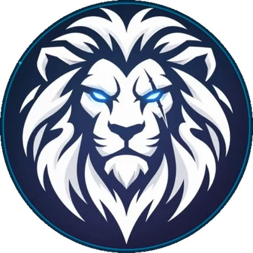

<div align="center">



# brave

**تعريب Scam With Your Friends: ترجمة، صوت عربي سريع، وتعرّف أدق على كلامك. بضغطة وحدة.**
Arabic translation, local AI voice and speech recognition for *Scam With Your Friends*.

[Discord](https://discord.gg/ZCxu8kXkS)

</div>

## للاعبين

1. حمّل `brave-Setup-x.y.z.exe` من صفحة [Releases](../../releases/latest) وشغّله.
2. افتح **brave**. يلقى اللعبة تلقائياً من Steam ويضبط الإعدادات حسب جهازك.
3. أغلق اللعبة واضغط **تطبيق التحسينات**، ثم شغّل اللعبة واختر **العربية**.

البرنامج يتحدّث لحاله عند صدور إصدار جديد. وبعد أي تحديث للعبة من Steam يكتشف التغيير وتقدر تعيد التطبيق بضغطة (أو يطبّق تلقائياً إذا فعّلت الخيار).

**ماذا يسوي؟**
- يكمل الترجمة العربية ويصححها (وتقدر تعدّل أي نص من تبويب «تعديل النصوص»).
- ردود المتصلين بالعربي وبلهجة تختارها (12 لهجة).
- صوت عربي بنموذج ذكاء اصطناعي محلي (10 أصوات) بدل صوت MOSS البطيء.
- تعرّف على كلامك بـ faster-whisper المحلي (عربي + كلمات إنجليزية).
- يصلح الحروف المعكوسة وغير المتصلة في نصوص اللعبة.
- «ضبط تلقائي» حسب المعالج وقرص اللعبة.

**أمان:** لكل ملف يتغيّر نسخة احتياطية داخل `ArabicPatcher_Backup`، وزر «استرجاع الأصلي» يرجّع كل شي.
مجاني وبدون مفاتيح API. أول تشغيل يحمّل نماذج الصوت والتعرف (يحتاج إنترنت مرة وحدة).

## For developers

```bash
npm ci
npm start            # copies icons/fonts, launches the app (needs engine/dist/patcher.exe, see below)
npm run pack         # unpacked build in dist/win-unpacked
npm run dist         # installer, no publishing
```

**Layout**

| Path | What |
|---|---|
| `main.js`, `preload.js`, `renderer/` | Electron app (UI, settings, auto-update, game detection) |
| `engine/patcher.py` | patch engine (bundles, catalog, prompts, DLL edits, backups), built with PyInstaller |
| `engine/supertts.py` | one helper exe: `--stt` recognition server, default TTS server |
| `plugin/ArabicFix.cs`, `ArabicTts.cs`, `ArabicStt.cs` | code that runs inside the game (text shaping, voice, recognition) |
| `plugin/ArabicPatch.cs` | Mono.Cecil tool that wires the plugin into the game's DLLs |
| `plugin/dist/` | prebuilt `ArabicFix.dll`, `ArabicPatch.exe`, Cecil (committed). `supertts.exe` is built locally/in CI |

**Build the engine and helper**

```powershell
python -m venv engine/.venv
engine/.venv/Scripts/pip install -r engine/requirements.txt pyinstaller
cd engine
../engine/.venv/Scripts/pyinstaller --noconfirm --onefile --name patcher --collect-all UnityPy patcher.py
../engine/.venv/Scripts/pyinstaller --noconfirm --onefile --name supertts --collect-all supertonic --collect-all onnxruntime --collect-all faster_whisper --collect-all ctranslate2 --collect-all av supertts.py
copy dist\supertts.exe ..\plugin\dist\
```

`plugin/dist/ArabicFix.dll` is compiled against the game's own Unity assemblies, so it is rebuilt only when the code in
`plugin/*.cs` changes: `plugin/build-plugin.ps1 -Managed "<game>\<name>_Data\Managed" -CecilDll <Mono.Cecil.dll>` (needs the .NET SDK).

**Releasing an update**

1. Change `build.publish.owner/repo` and `repository.url` in `package.json` to your GitHub repo.
2. Bump `version` in `package.json`, commit, then `git tag v1.0.1 && git push --tags`.
3. The `release` workflow builds the installer and attaches it (with `latest.yml`) to a GitHub Release. Installed copies of brave pick it up on next launch.

Locally: `GH_TOKEN=<token> npm run release` does the same.

> Windows note: building the NSIS installer on your own PC needs Developer Mode (symlinks) turned on, or just let the GitHub runner build it.

## License
MIT for this project's code. See [THIRD_PARTY.md](THIRD_PARTY.md) for the components it uses (including the model licenses).
brave is a community project, not affiliated with the game's developer, and contains no game files.
